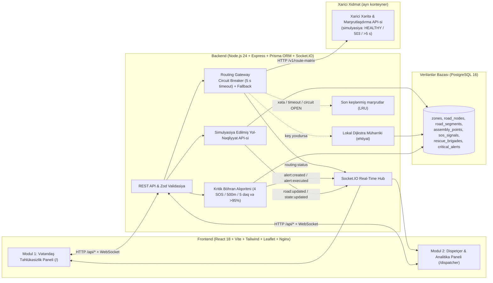

# Urban Crisis & Crowd Evacuation Engine

Fövqəladə hallar (zəlzələ, güclü sel, yanğın, sənaye qəzaları və kütləvi tədbirlər) zamanı vətəndaşların ən yaxın təhlükəsiz toplanış məntəqələrinə dinamik yönləndirilməsi və dispetçer mərkəzinin böhran koordinasiyası üçün hazırlanmış real-vaxt mikro-sistem.

---

## 1. Sistem Arxitekturası və Məlumat Axını (Architecture & Data Flow)



### API və Servis Axını:
1. **Vətəndaş Təxliyə Sorğusu (`GET /api/citizen/evacuation-plan`):**
   - İstifadəçinin seçdiyi rayon (`zoneId`) və ya koordinat (`lat`, `lng`) ən yaxın açıq yol qovşağına bağlanır.
   - `routingService.js` Dijkstra alqoritmi ilə `OPEN` və `CONGESTED` yol seqmentləri üzərindən bütün aktiv toplanış məntəqələrinə qısa yolu hesablayır (`CLOSED` yollar avtomatik kənarlaşdırılır).
   - `evacuationService.js` məntəqə doluluğu `>= 90%` olduqda və ya əsas yol bağlandıqda avtomatik olaraq növbəti təhlükəsiz məntəqəni və alternativ marşrutu təklif edir.
2. **SOS və Kritik Böhran Axını (`POST /api/citizen/sos`):**
   - Vətəndaşın SOS siqnalı (`FIRE`, `COLLAPSE`, `FLOOD`, `MEDICAL`) PostgreSQL-ə yazılır və `Socket.IO` ilə dispetçer panelinə ötürülür.
   - `crisisEngineService.js` son 5 dəqiqədə eyni zonada və ya 500 metr radiusda **ən azı 4 aktiv SOS siqnalı** olub-olmadığını yoxlayır. Şərt ödənərsə (və ya məntəqə doluluğu **95%-i keçərsə**), avtomatik **Qırmızı Həyəcan** yaradılır.
3. **Bir Kliklə Qərar İcrası (`POST /api/dispatcher/alerts/:id/execute`):**
   - Prisma `$transaction` daxilində: (a) mövcud/ehtiyat xilasetmə briqadası zonaya `DISPATCHED` edilir, (b) ehtiyat `STANDBY` toplanış məntəqəsi `OPEN` statusuna keçirilir (yoxdursa mobil məntəqə yaradılır), (c) xəbərdarlıq `EXECUTED` kimi bağlanır və bütün müştərilər canlı yenilənir.

---

## 2. İşə Salınma Təlimatı (Local & Docker Setup)

### Variant A: Docker Compose ilə (Tövsiyə olunan — 1 əmrlə)
**Tələblər:** Docker və Docker Compose

```bash
docker compose up --build -d
```

Xidmətlər işə düşdükdə Backend avtomatik olaraq Prisma sxemini PostgreSQL bazasına tətbiq edir (`prisma db push`) və Bakı şəhərinin 5 rayonu üzrə ilkin məlumatları (`zones`, `road_nodes`, `road_segments`, `assembly_points`, `rescue_brigades`) bazaya yükləyir.

- **Vətəndaş Paneli (Modul 1):** http://localhost:3000/
- **Dispetçer Paneli (Modul 2):** http://localhost:3000/dispatcher
- **Backend API & Healthcheck:** http://localhost:4050/api/health
- **Marşrut provayderinin vəziyyəti (Circuit Breaker):** http://localhost:4050/api/routing/status

Dayandırmaq üçün:
```bash
docker compose down
```

### Variant B: Hibrid Rejim (Backend + DB Docker-də, Frontend Local HMR ilə — İnkişaf üçün)
UI dəyişikliklərini real vaxtda görmək üçün:
```bash
docker compose up -d --build postgres backend
cd frontend && npm install && npm run dev
```
Brauzerdə açın: http://localhost:5173 (Vite proksisi `/api` və `/socket.io`-nu avtomatik `http://localhost:4050` ünvanına yönləndirir).

### Variant C: Tam Local Runtime ilə (Node.js 24 + PostgreSQL 16)
**Tələblər:** Node.js `v24.x` (`v24.22.1` ilə test edilib) və aktiv PostgreSQL 16 bazası

1. **Verilənlər bazasını işə salın** (məsələn, yalnız Postgres konteynerini qaldıra bilərsiniz):
   ```bash
   docker compose up -d postgres
   ```
2. **Backend-i quraşdırın və işə salın:**
   ```bash
   cd backend
   cp .env.example .env
   npm install
   npx prisma generate
   npx prisma db push
   npm run prisma:seed
   npm run dev
   # ayrı terminalda — simulyasiya olunmuş xarici marşrut API-si (port 4100):
   npm run routing-api
   ```
   *(`routing-api` işə salınmasa belə sistem çökmür — avtomatik ehtiyat marşrut rejimində işləyir.)*
3. **Frontend-i quraşdırın və işə salın:**
   ```bash
   cd frontend
   npm install
   npm run dev
   ```
4. Brauzerdə açın: http://localhost:5173

---

## 3. Testlərin İcra Olunması (Testing)

| Paket | Əmr | Nə yoxlanılır |
|---|---|---|
| Backend unit | `cd backend && npm test` | Dijkstra/rerouting, 90%/95% hədləri, 4 **fərqli** vətəndaş qaydası, klaster pəncərəsi, briqada seçimi, CORS, auth, validasiya |
| Backend integration | `cd backend && npm run test:integration` | Real PostgreSQL üzərində: SOS → Qırmızı Həyəcan, eyni anda icra (race-condition), SOS sahiblik tokeni (IDOR), Socket.IO kanal izolyasiyası (PII sızmır) |
| Frontend | `cd frontend && npm test` | AZ/EN lüğət paritet testi, Qırmızı Həyəcan paneli (Vitest + Testing Library) |

İnteqrasiya testləri ayrıca `urban_crisis_test` bazasından istifadə edir (əsas bazaya toxunmur):

```bash
docker compose up -d postgres
docker exec urban_crisis_postgres psql -U crisis_user -d urban_crisis -c "CREATE DATABASE urban_crisis_test"
cd backend && npm run test:integration
```

Fərqli ünvan üçün `TEST_DATABASE_URL` mühit dəyişənini təyin edin (adı `_test` ilə bitməlidir — qoruyucu yoxlama).

---

## 4. Dinamik Texniki Şərtlərə (Challenge Drop) Uyğunlaşma Yanaşması

Yarış ərzində hər saat əlavə olunan yeni tələblərə ("Challenge Drop") sürətli və təhlükəsiz reaksiya vermək üçün arxitektura aşağıdakı prinsiplər əsasında qurulub:

1. **Mərkəzləşdirilmiş Parametrlər (`backend/src/config/constants.js`):**
   - `REROUTE_OCCUPANCY_PERCENT` (`90`), `CRITICAL_OCCUPANCY_PERCENT` (`95`), `SOS_CLUSTER_MIN_COUNT` (`4`), `SOS_CLUSTER_RADIUS_METERS` (`500`), `SOS_CLUSTER_WINDOW_MINUTES` (`5`) sabitləri bir yerdə saxlanılır. Hədlər dəyişdikdə yalnız bu konfiqurasiya yenilənir.
2. **Prisma ORM Sxem Çevikliyi (`backend/prisma/schema.prisma`):**
   - Yeni təhlükə növləri (`HazardType` enum), prioritet kateqoriyalar (məs. yaşlılar/əlillər), və ya əlavə resurs atributları birbaşa Prisma sxeminə əlavə edilərək `npx prisma db push` ilə bazaya ötürülür.
3. **Təmiz Servis Ayrımı (`services/`):**
   - Qraf marşrutlaşdırması (`routingService.js`), təxliyə qərarı (`evacuationService.js`) və böhran mühərriki (`crisisEngineService.js`) DB-dən ayrılmış təmiz funksiyalar şəklində yazılıb. Yeni qayda (məs. külək istiqaməti, təhlükə radiusu və ya yeni prioritet çəkisi) əlavə edildikdə dərhal `vitest` testləri ilə yoxlana bilir.
4. **Simulyasiya və Real-Time Sinxronizasiya (`Socket.IO`):**
   - İstənilən yeni hadisə növü `io.emit('state:updated', ...)` kanalı ilə həm Vətəndaş, həm də Dispetçer ekranlarını yenidən yükləmədən (zero-refresh) sinxronlaşdırır.

---

## 5. Dispetçer Autentifikasiyası və Təhlükəsizlik Axını

Dispetçer panelinə (`/dispatcher`), yol bağlama əməliyyatlarına və simulyasiya idarəetməsinə yalnız autentifikasiyadan keçmiş operatorlar daxil ola bilər:

- **Şifrə Təhlükəsizliyi:** Parollar `node:crypto` (`scrypt` + fərdi random salt + `timingSafeEqual`) ilə heşlənir.
- **Sessiya İdarəetməsi:** `POST /api/auth/login` uğurlu olduqda `HS256` JWT token yaradılır və **HttpOnly / SameSite=Lax** cookie (`crisis_dispatcher_token`) olaraq təyin edilir (API testləri üçün `Authorization: Bearer <token>` də dəstəklənir).
- **Brute-Force Mühafizəsi:** Eyni IP-dən 15 dəqiqədə 10 uğursuz giriş cəhdi olduqda `HTTP 429` qaytarılır.
- **WebSocket İcazəsi:** Yalnız etibarlı dispetçer JWT-sinə sahib Socket.IO bağlantıları `dispatchers` otağına qoşulur və canlı SOS / Qırmızı Həyəcan hadisələrini qəbul edir.

### İlkin Dispetçer Hesabları (Seeded)
| İstifadəçi adı | Şifrə (Default) | Rol | Nişan Kodu |
|---|---|---|---|
| `dispatcher1` | `Fhn112!Crisis` | `DISPATCHER` | `FHN-112` |
| `commander` | `Cmd001!Crisis` | `COMMANDER` | `CMD-001` |

*(İstehsal mühitində `SEED_DISPATCHER_PASSWORD`, `SEED_COMMANDER_PASSWORD` və `JWT_SECRET` mühit dəyişənləri ilə dəyişdirilə bilər.)*

---

## 6. Challenge Drop #1: Prioritet SOS & Maneəsiz Təxliyə + Dinamik Çoxdillilik (`AZ | EN`)

Sistemə sonradan əlavə edilən tələblər əsasında iki kritik funksional qat tətbiq edilmişdir:

1. **Hərəkət Məhdudiyyətli Şəxs / Xüsusi Qayğı (`SPECIAL_CARE`) Rolu və Prioritet #1 SOS:**
   - Vətəndaş interfeysində `Standart Vətəndaş` və `Hərəkət Məhdudiyyətli / Xüsusi Qayğı` profili seçilə bilir.
   - `SPECIAL_CARE` rejimində göndərilən SOS müraciətləri bazada avtomatik `priorityLevel = 1` (**Kritik Prioritet / Priority #1**) statusu alır və Dispetçer panelində axının ən yuxarısında sabitləşdirilərək ani səs/vizual xəbərdarlıq yaradır.
   - Marşrutlaşdırma mühərriki (`routingService.js` + `evacuationService.js`) `accessibleOnly=true` rejimində pilləkənli/pandussuz yol seqmentlərini (`isWheelchairAccessible = false`) və yeraltı/əlçatmaz sığınacaqları avtomatik kənarlaşdıraraq **yalnız əlil arabası və tibbi nəqliyyat üçün uyğun (panduslu, maneəsiz)** marşrut və toplanış məntəqəsi təyin edir.
2. **Dinamik İkidilli İnterfeys (`AZ` / `EN` i18n):**
   - Naviqasiya panelində yerləşən `AZ | EN` keçidi vasitəsilə bütün Vətəndaş, Dispetçer, Giriş, Xəritə legendaları, bildirişlər (`toast`) və status etiketləri səhifəni yeniləmədən real vaxtda Azərbaycan və İngilis dilləri arasında dəyişdirilir.

---

## 7. Challenge Drop #2: Xarici Marşrut API-si Sıradan Çıxdıqda Circuit Breaker / Fallback

**Tələb:** xarici xəritə/marşrut API-si `HTTP 503` qaytardıqda və ya cavab **5 saniyəni** keçdikdə sistem çökməməli, avtomatik ehtiyat mexanizminə keçməli və vətəndaşa *"Oflayn / Ehtiyat marşrut rejimində işləyir"* bildirişi ilə xidmətə davam etməlidir.

**Həll arxitekturası:**

| Qat | Fayl | Məsuliyyət |
|---|---|---|
| Xarici provayder (simulyasiya) | `backend/src/external/` | Ayrı konteyner (`routing-api`), real HTTP. Rejimlər: `HEALTHY`, `DOWN` (503), `SLOW` (7 s) |
| HTTP klient | `backend/src/integrations/routingApiClient.js` | Cavab sxemi `zod` ilə yoxlanılır; yanlış cavab da xəta sayılır |
| Circuit Breaker | `backend/src/resilience/circuitBreaker.js` | `CLOSED → OPEN` (3 ardıcıl xəta), `OPEN` → 20 s sonra `HALF_OPEN` (1 sınaq), **5 s timeout** + `AbortController` |
| Marşrut keşi | `backend/src/resilience/routeCache.js` | Son uğurlu xarici marşrutlar (LRU, 30 dəq TTL). Açar yolların cari vəziyyətini (hash) ehtiva edir — **bağlanmış yoldan keçən köhnə marşrut heç vaxt verilmir** |
| Routing Gateway | `backend/src/services/routingGateway.js` | Heç vaxt exception atmır. Ardıcıllıq: **xarici API → keş → lokal yol qrafı (Dijkstra) → statik koordinat matrisi (düz xətt)** |

**Davranış:**
- Hər marşrut cavabında `routing` sahəsi: `mode` (`ONLINE`, `FALLBACK_CACHE`, `FALLBACK_LOCAL_GRAPH`, `FALLBACK_STRAIGHT_LINE`), `degraded`, `reason` (`EXTERNAL_UNAVAILABLE`, `EXTERNAL_TIMEOUT`, `CIRCUIT_OPEN`, `EXTERNAL_UNREACHABLE`, `INVALID_RESPONSE`).
- Circuit `OPEN` olduqda sorğular ölü xidməti gözləmədən **~5 ms**-də lokal ehtiyatdan cavablanır.
- Vəziyyət dəyişdikdə `routing:status` Socket.IO hadisəsi bütün müştərilərə göndərilir: vətəndaş ekranında sarı *"Oflayn / Ehtiyat marşrut rejimində işləyir"* paneli və bildiriş görünür, marşrut avtomatik yenidən hesablanır.
- Arxa plan **health probe** (5 s) xidmət bərpa olunduqda istifadəçi trafiki olmadan belə sistemi avtomatik `ONLINE` rejimə qaytarır.
- 90% doluluq, yol bağlanması və maneəsiz marşrut qaydaları hər iki rejimdə eyni işləyir (qərar məntiqi `rankEvacuationOptions` marşrut mənbəyindən asılı deyil).
- `/api/health` provayder çökəndə `200 {"status":"degraded"}` qaytarır — sistem işləkdir.

**Demo:** Dispetçer panelində `API: 503`, `API: >5 san`, `API: Bərpa et` düymələri; və ya real çöküş üçün:
```bash
docker compose stop routing-api    # vətəndaş paneli ehtiyat rejimə keçir
docker compose start routing-api   # ~20 s ərzində avtomatik ONLINE
```

**Testlər:** `tests/unit/circuitBreaker.test.js`, `tests/unit/routingGateway.test.js`, `tests/integration/routingResilience.int.test.js` (real HTTP: 503, timeout, circuit open, keş, bağlantı kəsilməsi, bərpa), `frontend/src/components/citizen/RoutingModeBanner.test.jsx`.

---

## 8. Əsas API Endpoint-ləri

| Metod | Endpoint | İcazə | Təyinat |
|---|---|---|---|
| `POST` | `/api/auth/login` | Açıq | Dispetçer girişi (HttpOnly JWT cookie) |
| `POST` | `/api/auth/logout` | Açıq | Dispetçer sessiyasının sonlandırılması |
| `GET` | `/api/auth/me` | Dispetçer JWT | Cari operator profili |
| `GET` | `/api/zones` | Açıq | Şəhər rayonlarının siyahısı |
| `GET` | `/api/citizen/evacuation-plan` | Açıq | Ən yaxın məntəqələr, doluluq %, aktiv/alternativ və maneəsiz (`accessibleOnly`) marşrut |
| `POST` | `/api/citizen/sos` | Açıq | 1 kliklə SOS göndərmək (`citizenCategory`: `STANDARD` \| `SPECIAL_CARE`) |
| `PATCH` | `/api/citizen/safe` | Açıq | `"Təhlükəsizəm"` statusunu yeniləmək |
| `GET` | `/api/routing/status` | Açıq | Xarici marşrut API-si və Circuit Breaker vəziyyəti |
| `GET` | `/api/traffic/roads` | Açıq | Yol-nəqliyyat şəbəkəsinin cari vəziyyəti |
| `PATCH` | `/api/traffic/roads/:id/status` | **Dispetçer JWT** | Yolun statusunu dəyişmək (`OPEN`, `CONGESTED`, `CLOSED`) |
| `GET` | `/api/dispatcher/dashboard` | **Dispetçer JWT** | Dispetçer panelinin tam canlı məlumatı (Priority #1 sıralamalı SOS axını) |
| `PATCH` | `/api/dispatcher/shelters/:id/occupancy` | **Dispetçer JWT** | Toplanış məntəqəsinin doluluğunu/statusunu yeniləmək |
| `POST` | `/api/dispatcher/sos/:id/dispatch` | **Dispetçer JWT** | SOS siqnalına xilasetmə briqadası yönləndirmək |
| `POST` | `/api/dispatcher/alerts/:id/execute` | **Dispetçer JWT** | Qırmızı Həyəcan qərarını 1 kliklə icra etmək |
| `POST` | `/api/simulation/*` | **Dispetçer JWT** | Demo ssenariləri (`sos-burst`, `road-toggle`, `occupancy-spike`, `routing-api`, `reset`) |
